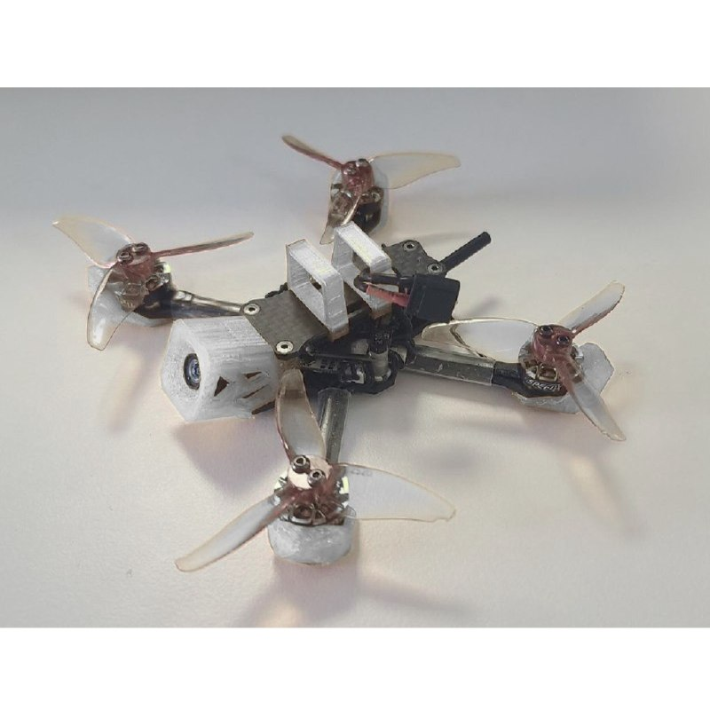
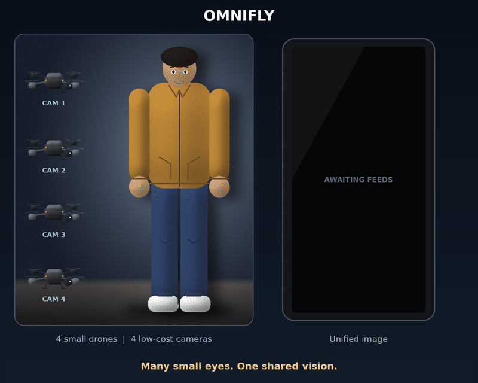

## What Makes OmniFLY Different?

Traditional aerial imaging often relies on a single expensive camera mounted on a large drone. While this approach can provide high-quality images, it also creates a major limitation: the entire imaging system depends on one device. If the camera or drone is damaged, the whole system may be affected.

This led to a different question: **Why rely on one complex and expensive eye when nature uses thousands of small ones?**

OmniFLY takes inspiration from the compound eyes of insects, such as flies. Instead of relying on one large optical system, it explores the idea of using multiple small, affordable drones, each equipped with a low-cost camera and responsible for observing a specific part of the environment.

Working together, these drones can capture different perspectives and combine their individual images into one larger, unified picture.

The core idea is simple:

- **Multiple small drones** instead of one large imaging platform.
- **Affordable cameras** instead of relying on a single expensive camera.
- **Distributed vision** where each drone focuses on a specific area.
- **Collaborative imaging** where individual perspectives are combined into one picture.

Just as thousands of individual visual units contribute to an insect's perception of the world, OMNIFLY explores how multiple autonomous flying units could work together to create a shared view of their surroundings.

**Many Small Eyes. One Shared Vision.**

<table>
  <tr>
    <td align="center" valign="middle" width="50%">
      
    </td>
    <td align="center" valign="middle" width="50%">
      
    </td>
  </tr>
</table>

## Key Features

- **Distributed Aerial Vision** – Multiple drones observe different areas of the environment simultaneously, creating a broader field of view.

- **Low-Cost Camera Systems** – Each drone uses an affordable camera instead of relying on one expensive imaging system.

- **Collaborative Image Processing** – Individual images captured by different drones are combined into one unified picture.

- **Modular Drone Design** – Each drone operates as an individual unit, allowing the system to be expanded with additional drones.

- **Scalable Swarm Concept** – The system explores how adding more drones can increase environmental coverage and provide more visual information.

## 3D Model & CAD Design

The OmniFLY micro-drone prototype features a compact quadcopter design with a focus on lightweight construction and efficient integration of onboard electronics.

The 3D model was prepared in **3MF format**, containing the complete project geometry and individual structural elements arranged within a single project file.

### 3D Model File

| File | Description |
|---|---|
| `OmniFLY.3mf` | Complete 3D model of the micro-drone, including its structural components and camera housing. |

The 3MF file is available in the `3D-Models` directory.

---

## Bill of Materials (BOM)

The following table presents the selected hardware components for the OmniFLY prototype.

| Component | Model / Specification | Quantity |
|---|---|---:|
| **Frame** | Kayoumini 2.5" Frame Kit | 1 |
| **Flight Controller / ESC** | Flywoo GOKU F405 HD 1-2S ELRS V2 AIO | 1 |
| **Brushless Motors** | GEPRC SPEEDX2 1202.5 – 10000KV | 4 |
| **Propellers** | Gemfan 2520 | 1 set |
| **Camera / Video Transmission** | DJI O4 Air Unit | 1 |
| **Radio Receiver** | ExpressLRS (ELRS), integrated into AIO | 1 |
| **Battery** | Flywoo Explorer 550mAh HV 2S 80C | 1 pack (2 batteries) |

### Hardware Overview

The selected configuration combines a compact 2.5-inch frame with four brushless motors and a 2S battery system.

The Flywoo GOKU F405 AIO integrates the flight controller, ESC and ELRS receiver into a single board, helping reduce weight and simplify the electronics layout.

The DJI O4 Air Unit provides onboard imaging and digital video transmission.

This compact hardware platform is intended to serve as an individual aerial unit within the larger OmniFLY distributed imaging system.
## Software Architecture & Code Structure

The OmniFLY software is organized into three main modules, separating the core Python package, ROS 2 integration, and simulation environment.

### Project Structure

```text
OmniFLY/
│
├── omnifly_py/
│   ├── examples/       # Example scripts and implementations
│   ├── omnifly_py/     # Core Python package
│   ├── resource/       # Package resources
│   ├── test/           # Unit and package tests
│   ├── package.xml
│   ├── setup.cfg
│   └── setup.py
│
├── omnifly_ros2/
│   ├── config/         # Configuration files
│   ├── launch/         # ROS 2 launch files
│   ├── omnifly/        # ROS 2 package source code
│   ├── resource/       # Package resources
│   ├── test/           # Package tests
│
└── omnifly_sim/
    ├── config/         # Simulation configuration
    ├── omnifly_sim/    # Simulation package source code
    ├── resource/       # Package resources
    └── test/           # Simulation tests
```

### Main Modules

**1. `omnifly_py` – Core Python Package**

Contains the main Python package, example implementations, and supporting resources. It provides the foundation for the project's Python-based software.

**2. `omnifly_ros2` – ROS 2 Integration**

Contains the ROS 2 package, including launch files, configuration files, and the source code required for integrating OmniFLY with the ROS 2 ecosystem.

**3. `omnifly_sim` – Simulation Environment**

Dedicated to the simulation component of OmniFLY. It contains simulation-related source files, configuration files, and supporting resources.

### Development Approach

The modular structure is intended to keep the core software, ROS 2 integration, and simulation components organized independently, making the project easier to maintain, develop, and extend.
## Future Improvements

- Develop multi-drone coordination capabilities to enable multiple aerial units to operate collaboratively.
- Implement image stitching and panoramic reconstruction to combine images captured from different drones into a unified visual representation.
- Explore real-time image synchronization and data sharing between individual drones.
- Improve relative positioning and spatial awareness to support more accurate collaborative imaging.
- Optimize camera calibration, image alignment, and processing algorithms for improved visual consistency.
- Explore autonomous flight strategies for coordinated environmental coverage.
- Investigate scalable communication and processing architectures to support larger drone formations.
- Improve simulation and testing environments for reliable multi-drone operation.

## Additional Projects

Explore more robotics, mechatronics, autonomous systems, and 3D-printing projects on my [GitHub profile](https://github.com/Dimash-X).

## Contact

For questions, suggestions, or project improvements, feel free to contact me at [xomidad@gmail.ru](mailto:xomidad@gmail.ru).

## Disclaimer

This project is developed for educational and experimental purposes. The OmniFLY concept explores distributed aerial vision using multiple small camera-equipped drones.

Anyone building, modifying, or operating the system is responsible for ensuring safe mechanical assembly, electrical connections, flight operations, and compliance with applicable aviation regulations.

The author is not responsible for any damage, injury, or losses resulting from the construction or use of this project.

## License

The licensing terms for this project are specified in the [LICENSE](LICENSE) file.
